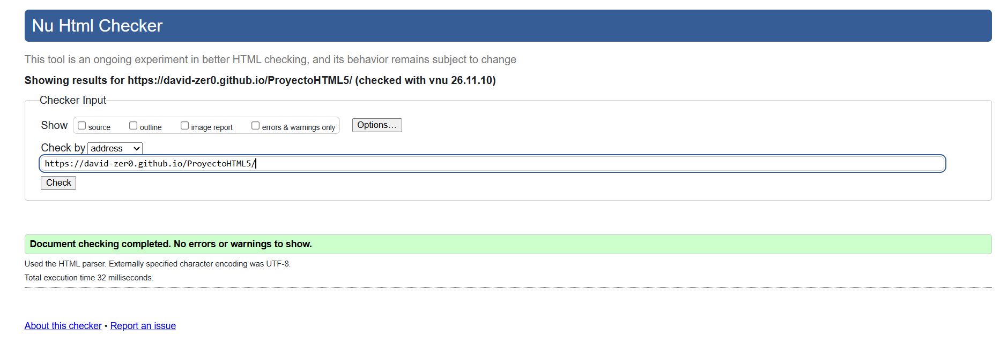
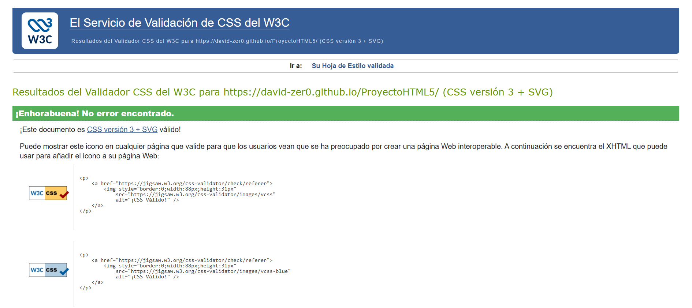
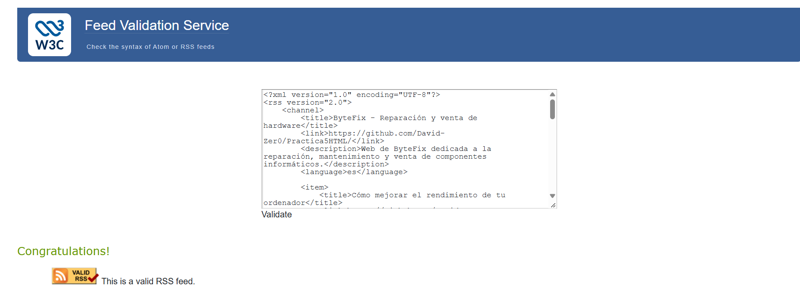

# ByteFix - Reparación y venta de hardware informático

ByteFix es un sitio web ficticio dedicado al mundo del hardware y la informática. Su temática principal es la reparación, el mantenimiento y la venta de componentes informáticos.

El objetivo de esta página web es ofrecer información sobre diferentes componentes de un ordenador, mostrar servicios de reparación, presentar contenido multimedia relacionado con el montaje de equipos y permitir a los usuarios contactar con la empresa mediante un formulario.

## Autoría

- **Nombre y apellidos:** Francisco David Villasclaras García
- **Curso:** 1.º de Desarrollo de Aplicaciones Multiplataforma (DAM).
- **Módulo:** Lenguajes de Marcas y Sistemas de Gestión de Información (LMSGI).
- **Fecha:** Noviembre de 2026.

## Sitio publicado

- **Web en GitHub Pages:** [Abrir sitio] (https://david-zer0.github.io/ProyectoHTML5/index.html)
- **Repositorio:** [Abrir repositorio](https://github.com/David-Zer0/ProyectoHTML5)

## Estructura del proyecto

El proyecto está organizado en diferentes páginas HTML, carpetas de recursos multimedia y archivos de configuración.

- `index.html`: página principal de ByteFix. Presenta la empresa, su temática y los principales servicios que ofrece mediante diferentes secciones y enlaces a otras páginas.
- `blog.html`: artículo relacionado con el hardware y el mantenimiento informático. Incluye diferentes elementos de formato de texto, citas, listas y ejemplos de contenido.
- `tabla.html`: página que muestra una tabla con los diferentes servicios de reparación, sus precios y los tiempos estimados de realización.
- `galeria.html`: galería dedicada al hardware informático. Incluye imágenes de componentes, contenido de audio, vídeos y recursos gráficos en formato SVG.
- `formulario.html`: formulario de contacto y solicitud de servicios. Permite introducir datos, seleccionar opciones y adjuntar información mediante diferentes tipos de controles HTML.
- `rss.xml`: archivo XML que contiene el canal RSS de ByteFix, con información y enlaces a las publicaciones del sitio.
- `css/estilos.css`: hoja de estilos utilizada para establecer la presentación visual de las páginas.
- `img/`: carpeta que contiene las imágenes, fotografías y gráficos SVG utilizados en el proyecto.
- `audio/`: carpeta que contiene los archivos de sonido utilizados en la página multimedia.
- `video/`: carpeta que contiene los vídeos relacionados con el montaje y el hardware informático.

## Tecnologías utilizadas

- **HTML5:** creación de la estructura y el contenido de las páginas web mediante etiquetas semánticas.
- **CSS:** aplicación de estilos y presentación visual del sitio.
- **XML y RSS:** creación del documento de sindicación de contenidos.
- **Git:** control de versiones y seguimiento de los cambios realizados durante el desarrollo.
- **GitHub:** almacenamiento y gestión del repositorio del proyecto.
- **GitHub Pages:** publicación del sitio web para que pueda consultarse desde Internet.

## Características principales

- Navegación entre cinco páginas HTML relacionadas con la temática de ByteFix.
- Utilización de etiquetas semánticas de HTML5, como `header`, `nav`, `main`, `section`, `article` y `footer`.
- Página principal con presentación de la empresa y enlaces a sus contenidos.
- Artículo con diferentes elementos de formato de texto, citas y listas.
- Tabla accesible con información sobre precios y servicios de reparación.
- Galería de imágenes de componentes informáticos y recursos gráficos SVG.
- Contenido multimedia mediante archivos de audio y vídeo.
- Formulario con diferentes tipos de campos y validación HTML.
- Canal RSS para facilitar la sindicación y consulta de las novedades del sitio.
- Organización de los archivos en carpetas para facilitar su mantenimiento.

## Validación

Para comprobar que los documentos cumplen con los estándares correspondientes, se utilizan herramientas de validación para HTML5, CSS y RSS.

### HTML

Se incluye la captura del resultado obtenido al validar los documentos HTML del proyecto.

### CSS

Se incluye la captura del resultado obtenido al validar la hoja de estilos CSS.

### RSS

Se incluye la captura del resultado obtenido al validar el documento RSS.

## Dificultades encontradas

Durante el desarrollo del proyecto han surgido diferentes dificultades técnicas que se han ido solucionando:

1. **Organización de las etiquetas HTML5:** al principio resultó complicado organizar correctamente las etiquetas semánticas y los diferentes elementos de cada página. Se solucionó estructurando el contenido mediante etiquetas como `header`, `nav`, `main`, `section`, `article` y `footer`, procurando mantener una organización coherente.

2. **Incorporación de contenido multimedia:** surgieron dificultades al trabajar con diferentes formatos de imágenes, audio, vídeo y gráficos SVG. Se solucionaron organizando los recursos en carpetas independientes y utilizando las etiquetas HTML correspondientes, como `img`, `audio` y `video`.

3. **Problemas al subir archivos grandes a GitHub:** al intentar realizar un `push`, GitHub rechazó el vídeo de montaje del ordenador porque superaba el límite máximo de 100 MB por archivo. Se solucionó comprimiendo el vídeo mediante HandBrake, actualizando el último commit y sincronizando correctamente el repositorio remoto.

4. **Creación y validación del documento RSS:** fue necesario prestar atención a la estructura XML, las etiquetas y los elementos obligatorios del canal RSS. Se solucionó organizando correctamente los elementos `channel` e `item` y revisando la sintaxis del documento.

## Decisiones técnicas

### Organización de los archivos

Se ha optado por organizar el proyecto mediante diferentes carpetas según el tipo de recurso. Los documentos HTML se encuentran en la carpeta principal, mientras que las imágenes, los archivos de audio, los vídeos y los estilos CSS están separados en sus respectivas carpetas.

Esta organización facilita la localización de los archivos y permite mantener el proyecto de forma más ordenada.

### Elementos comunes entre páginas

Las diferentes páginas comparten una estructura de navegación y una organización visual coherente. Se mantiene una cabecera con la identidad de ByteFix, un menú de navegación para acceder a las distintas secciones y un pie de página con información complementaria.

### Diferencias entre páginas

Cada documento tiene una finalidad diferente:

- `index.html` presenta la empresa y sus servicios.
- `blog.html` desarrolla información mediante un artículo.
- `tabla.html` organiza los precios y servicios en formato tabular.
- `galeria.html` muestra imágenes y contenido multimedia.
- `formulario.html` permite introducir información y realizar solicitudes.

De esta manera, cada página aporta un tipo de contenido diferente sin perder la coherencia general del sitio.

### Elección de formatos de imagen

Se han utilizado diferentes formatos según las necesidades de cada recurso:

- **JPG:** para fotografías de componentes y equipos informáticos.
- **PNG:** para imágenes que necesitan conservar una buena calidad y transparencia.
- **WEBP:** para reducir el tamaño de las imágenes manteniendo una calidad adecuada.
- **SVG:** para logotipos y gráficos vectoriales, ya que permiten ampliar las imágenes sin perder calidad.

### Uso de rutas relativas

Se han utilizado rutas relativas para enlazar los documentos HTML y los recursos multimedia. Por ejemplo, para mostrar una imagen almacenada en la carpeta `img` se utiliza una ruta como `img/hardware.jpg`.

Esto permite que los archivos puedan trasladarse conjuntamente sin tener que modificar las rutas, siempre que se mantenga la estructura de carpetas.

### Preparación para la siguiente práctica de CSS

El proyecto se ha organizado utilizando una estructura HTML semántica y una hoja de estilos independiente en `css/estilos.css`.

Esto facilita la incorporación y modificación de estilos en futuras prácticas, permitiendo cambiar la apariencia de las páginas sin tener que modificar continuamente su contenido HTML.
